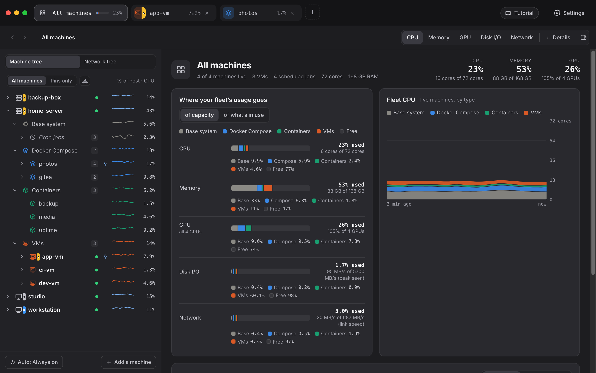
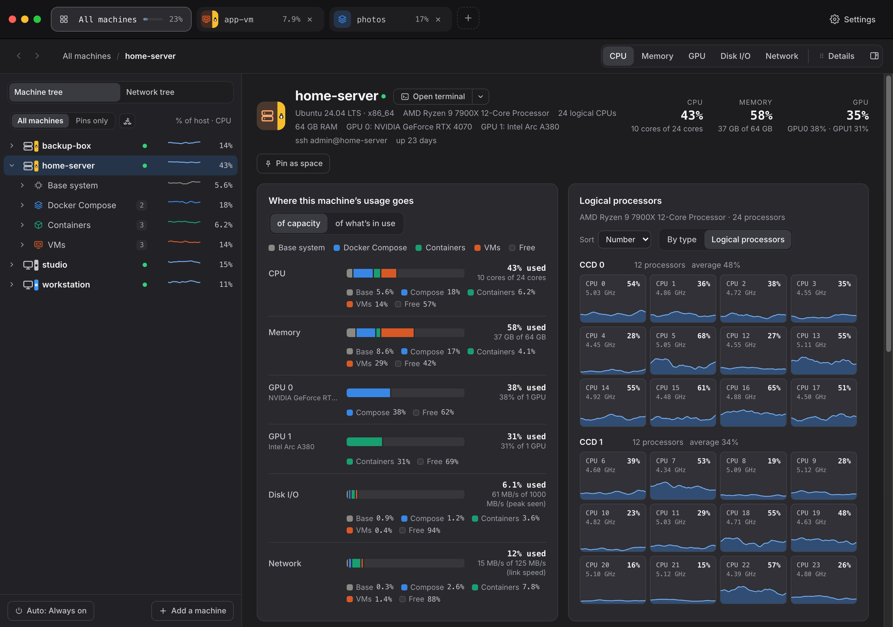
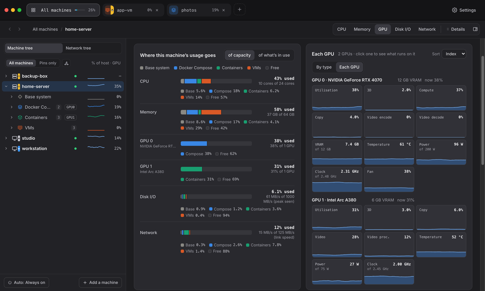
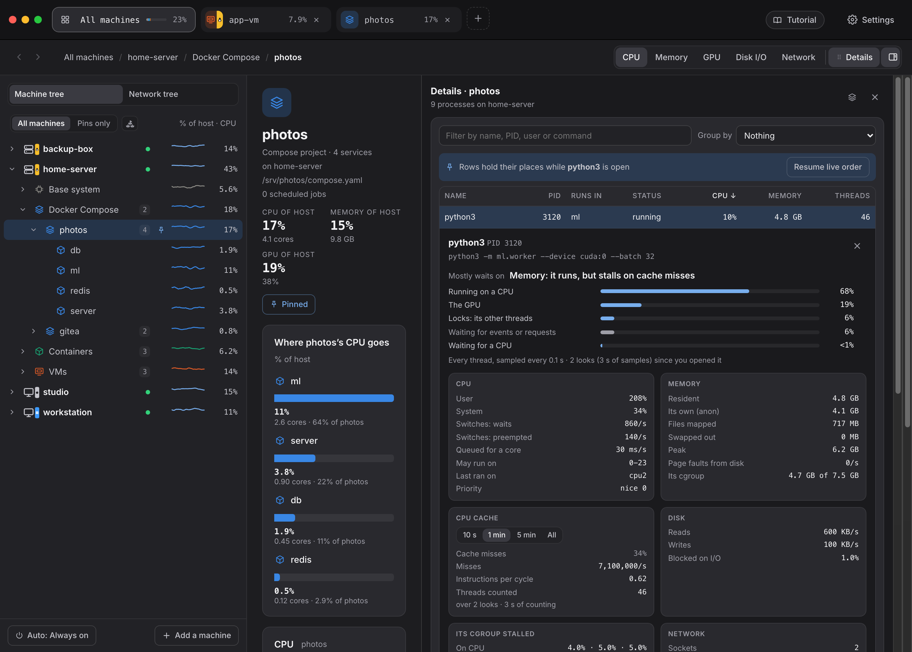
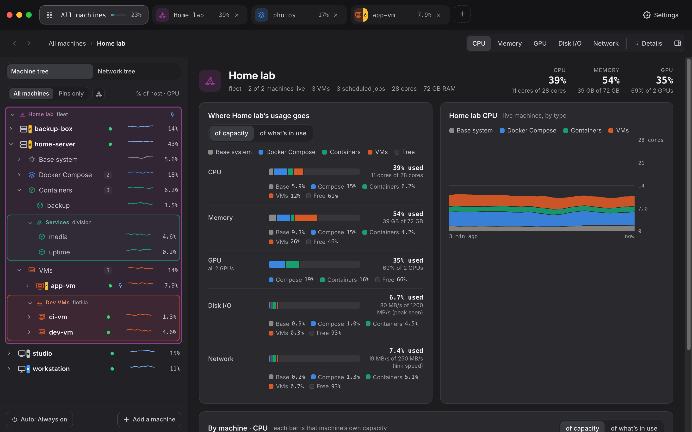
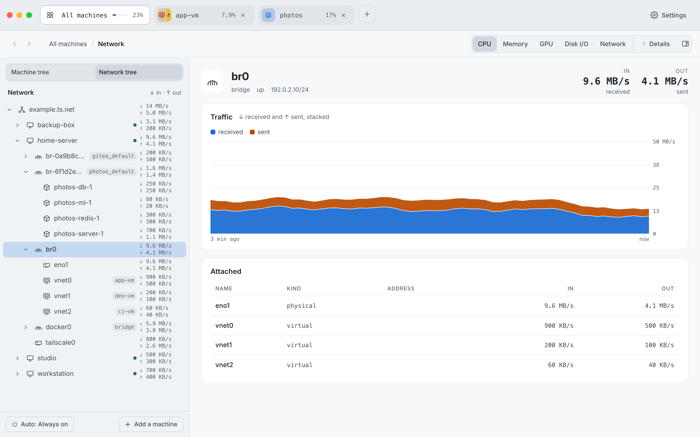
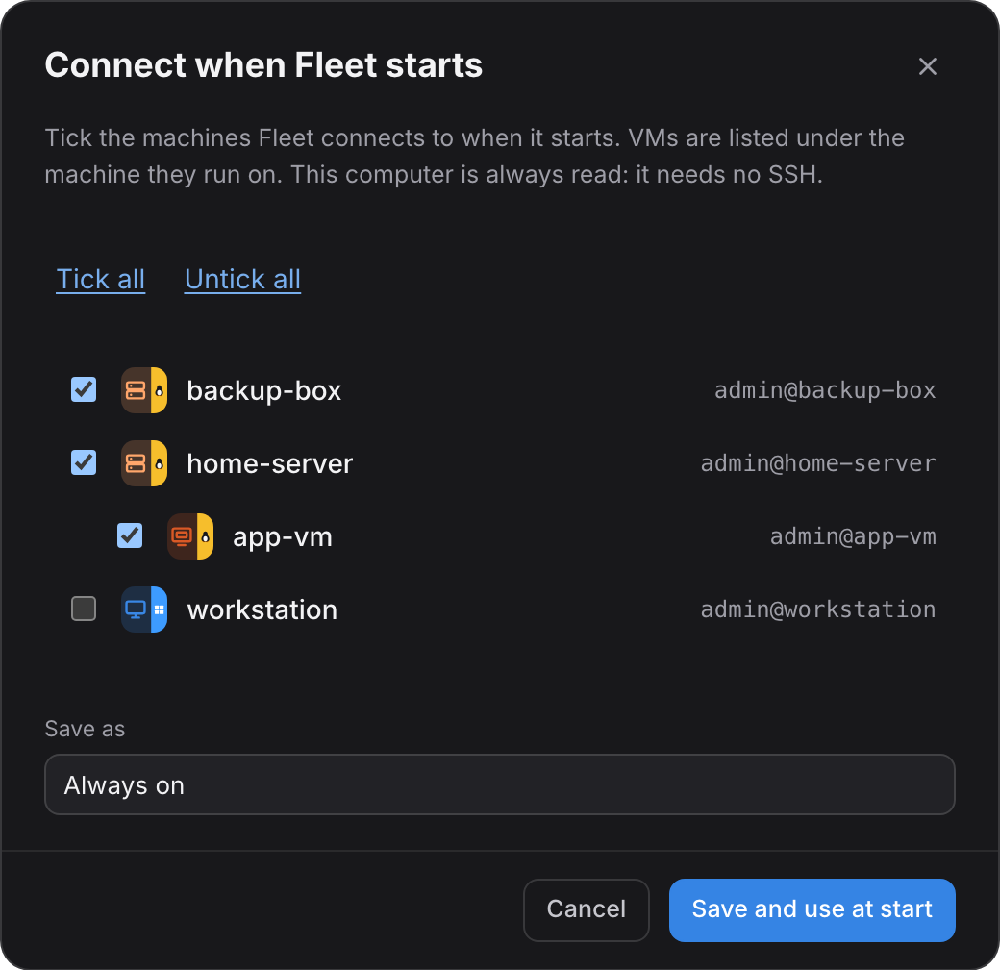
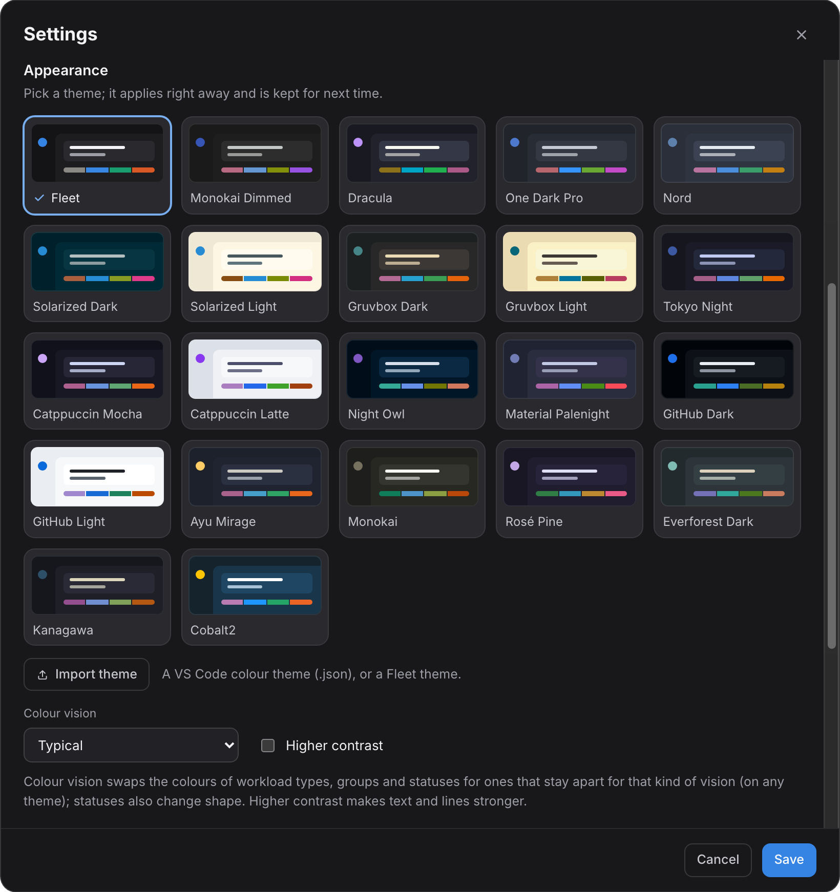

<div align="center">

# Fleet

**Every machine you manage, live, in one tree, and where each one's usage goes.**

[](COPYING)
[](#install)
[](#add-your-machines)
[](https://gitlab.com/mission-center-devs/mission-center)

[What it shows](#what-it-shows) · [Tour](#tour) · [Getting started](#getting-started) · [Configuration](#configuration) · [Keyboard](#keyboard-shortcuts) · [How it works](#how-it-works) · [Roadmap](#roadmap) · [Contributing](#contributing)

</div>

---

Fleet is a task manager for all your machines at once: laptops, servers, VMs, Docker Compose projects,
containers and the scheduled jobs inside them. It's a fork of
[Mission Center](https://gitlab.com/mission-center-devs/mission-center), which shows one Linux machine;
Fleet shows the whole fleet as a tree, live:

```
home-server (Linux)
├─ Base system                      the OS, daemons, apps
│  └─ Cron jobs                     crontab, systemd timers, …
├─ Docker Compose
│  └─ photos: server, ml, redis, db
├─ Containers: media, backup, …
└─ VMs
   └─ app-vm                        a machine again, all the way down
```

It reads each machine over SSH, **read-only**, and installs nothing on it. Everything stays on your
computer: Fleet listens on `127.0.0.1` only.



*All machines.* In the tree, each machine splits into **Base system** (the OS, its daemons and apps, with
its **Cron jobs** under it), **Docker Compose** (projects, then their services), **Containers** and **VMs**.
Every row has a sparkline and its share of the host. The page shows where the fleet's usage goes, split by
those same types. The bar along the top holds your **spaces**: All machines, plus anything you **pin**
(here the VM app-vm and the Compose project photos), each opening the tree on just that.

## What it shows

**The tree.** Machines, their base system, Docker Compose projects and services, containers, VMs (machines
again, all the way down) and scheduled jobs (crontab, systemd timers, launchd, Windows Scheduled Tasks),
each with a live sparkline. Every machine's tile shows its OS at a glance. A row with no room for its name
beside its kind, host, count or GPU tag puts those on a second, smaller line, so the name stays whole. A
second tree shows the network: tailnet, machines, interfaces and bridges, VMs and containers, with traffic
on each.

**Where the usage goes.** CPU, memory, GPU, disk I/O and network for any machine, group or all of them,
split by Base system, Compose, containers and VMs, as a share of capacity or of what's in use.

**Hardware, up close.** Logical processors one graph each, grouped by CCD, P/E cores or Apple core
clusters. Each GPU as a group of live tiles, like Task Manager: 3D, compute, copy, video encode and decode,
VRAM and shared memory, temperature, power, clocks and fan, for NVIDIA, AMD, Intel and Apple GPUs. Each
disk and each interface. Pick any of them to see just what runs there.

**Details.** A sortable, filterable process list for any node, grouped by CPU group, owner, user or status,
with the columns you choose, docked beside the overview if you like. Click a process for what it mostly
waits on (CPU, disk, memory, GPU, locks, network), its cache misses over a lookback, limits, sockets, files
and threads; the list holds still while it's open.

**Containers and VMs, counted once.** A VM on its host costs what the host gives it (its QEMU process, as
`htop` shows it, plus guest memory on huge pages, which `htop` leaves out); its own page shows what the guest
reports, without a ballooned guest's balloon. On a Mac,
Docker Desktop's VM folds into Base system, and Details lists each container's processes from inside it.
Look inside one with a throwaway helper container or by running Fleet's inspector in its container.

**Machines and connections.** **+ Add a machine** walks you through getting a Linux, Windows or Mac machine
ready for SSH and tests it. Offline machines say why, in plain language, with the steps to fix it. The dot
on a machine's row turns its connection off and on; **Auto** picks which machines Fleet connects to when
it starts (none until you choose, all, or a set you tick), so a start at login asks for no key you didn't
want. **Open terminal** sshes to a machine, or opens a shell in a container, in the terminal you pick, or
**inline**, split below the page, each scrolling on its own, with its own text size (A− A+) apart from Fleet's zoom; each keeps running through a reload, Fleet restarting
or quitting (its shell lives in tmux), and reconnects when the connection drops (with [ttyd](https://github.com/tsl0922/ttyd): `brew install ttyd`
or `sudo apt install ttyd`; Settings › Terminal picks a login shell, tmux or your own command, and can make inline the default).
The terminals are there from the start: a tab for each connected computer, each starting when you first go to it. **+**
opens one on any machine or container; the button left of the tabs minimizes them (they keep running), and the one at
the bottom left of the pane, or ⌘J, brings them back.

**Folding the tree.** The row above Auto and Add a machine folds the whole tree: **~** collapses everything and keeps
what was open, and pressed again brings exactly that back; **F~** opens every node at every depth, or closes them all.

**Spaces and groups.** Pin any machine, VM, project, container or group to the space bar. Drag a box over
items at the same level (or drag a row by its handle) to group them: a **fleet** of machines, a
**flotilla** of VMs, a **division** of containers, a **section** of cron jobs, a **squadron** of Compose
projects, a **task force** when mixed, each with its own colour and icon, its own all-up view, folding and
pinning.

**Yours to read.** 22 themes (Fleet's own, Monokai Dimmed, Dracula, Nord, Solarized, Catppuccin, …) or
import any VS Code colour theme. A colour-blind mode for protanopia, deuteranopia, tritanopia or
monochromacy (colours checked to stay apart for each; statuses also change shape), and higher contrast.
Right-click anything for what fits it; a keyboard shortcut for everything.

## Tour

The pictures show a made-up fleet: a Linux home server with two GPUs, Compose projects, containers and
VMs; the Mac that Fleet runs on; a Windows PC; and a small backup box.
[docs/fleet/screenshots/make.mjs](docs/fleet/screenshots/make.mjs) draws them from that demo data with
Fleet's own page, so they can be redrawn whenever the app changes.

### A machine, processor by processor



*home-server's page.* The top says what the machine is (OS, CPU, GPUs, how Fleet reaches it, uptime) and
how busy its CPU, memory and GPUs are now. **CPU › Logical processors** gives every logical processor a
live tile, grouped the way the chip is built: by **CCD** on AMD (a chiplet of cores that share one L3
cache), by **P-cores and E-cores** on Intel, by core cluster on Apple silicon. Click a processor or a
group's name, and Details lists only the processes that last ran there.

### Each GPU



*GPU › Each GPU.* Every GPU is a group of live tiles, one for each metric it reports, like Task Manager.
Here GPU 0 runs the photo library's machine learning and GPU 1 transcodes video for the media container;
the tree tags each row with the GPU it uses (`GPU0`, `GPU1`). Click a GPU to see what runs on it over time.

### Details and its drop-down



*Details, docked beside the Compose project photos.* **Details** is the process list of whatever you
select, here docked beside its page (⌘⇧D, or drag the Details pill to the right). Click a process for its
drop-down. It samples every thread for as long as it's open and says what the process mostly waits on:
this ML worker runs, but stalls on memory. Below are its **cache misses** over a lookback you pick (10 s,
1 min, 5 min or all), and its CPU, memory, disk, cgroup, sockets, files and busiest threads. The list holds
still while the drop-down is open.

### Groups and spaces



*A fleet, a division and a flotilla.* Drag a box over items at the same level to group them. A group is
named for what's in it: a **fleet** of machines, a **flotilla** of VMs, a **division** of containers, a
**section** of cron jobs, a **squadron** of Compose projects, and a **task force** when it's mixed. Each
kind has its own colour and icon, and outlines its members in the tree. Here the fleet Home lab holds
home-server and backup-box. It's selected, so the page adds up its machines, and it's pinned as a space.

### The network tree



*The network tree, in the GitHub Light theme.* The second tree starts from your **tailnet** (your
Tailscale network): each machine, its interfaces and bridges, the containers on each Docker network and
each VM's interface (vnet0 is app-vm's), with traffic in and out on every row. Here the bridge br0 is
selected: its traffic over time, and what's attached to it.

### Which machines connect at start



*Choose machines, from Auto.* Fleet reads a machine only while its connection is on; the dot on its row turns
it off and on. **Auto**, at the bottom of the tree, picks which machines Fleet connects to when it starts:
**None** until you choose, **All**, or a set you tick and name here, with VMs under the machine they run
on. So a start at login asks for no SSH key you didn't want.

### Themes and colour vision



*Settings › Appearance.* Pick one of 22 themes, or import a VS Code colour theme. **Colour vision** swaps
the colours of workload types, groups and statuses for ones that stay apart with protanopia, deuteranopia,
tritanopia or monochromacy, and statuses change shape as well. **Higher contrast** makes text and lines
stronger.

## Getting started

### Install

Download Fleet from [Releases](https://github.com/MarcWolpert/fleet/releases/latest):

| | |
|---|---|
| **macOS** (Apple silicon) | `Fleet-<version>-macos-arm64.zip`: unzip, drag **Fleet.app** to Applications, open it. Fleet.app isn't notarized yet, so the first time macOS says it can't verify it: choose **Done**, then System Settings › Privacy & Security › **Open Anyway**. If macOS says the app is damaged instead, run `xattr -dr com.apple.quarantine /Applications/Fleet.app` once. It needs Python 3.11 or newer on the Mac (`brew install python`). |
| **Linux** (x64 or arm64) | `fleet-<version>-linux-x64.tar.gz` or `-linux-arm64.tar.gz`: `tar -xzf fleet-*.tar.gz && fleet-*/install.sh`, then open Fleet from your app menu or run `fleet`. It needs Python 3.11+; the window is Chrome, Chromium or Edge in app mode when one is installed, otherwise your browser. `uninstall.sh` removes it. |

Or run it from source, anywhere with Python 3.11+:

```bash
git clone https://github.com/MarcWolpert/fleet.git && cd fleet/live
./fleet-live          # fleet-live.cmd on Windows; then open http://127.0.0.1:4518/
```

The first run writes `~/.config/fleet/machines.toml` with just this computer. Add the rest from the app.

### Add your machines

Use **+ Add a machine** at the bottom of the tree. Give it an SSH destination, a name and its system; it
tests the connection before it adds anything. What each machine needs:

| | |
|---|---|
| **Any** | You can `ssh` to it without a password (`ssh-copy-id user@host` if it asks). A name from `~/.ssh/config` or a Tailscale name works too. |
| **Linux** | `python3` (most have it). |
| **Windows** | OpenSSH Server (Settings › System › Optional features) and your key in `C:\Users\you\.ssh\authorized_keys`, or for an administrator account in `C:\ProgramData\ssh\administrators_authorized_keys`. |
| **macOS** | Remote Login on (System Settings › General › Sharing) and `python3` from the Command Line Tools: `xcode-select --install`. |
| **A VM** | Add it like any machine, then set **Runs on** in Settings to nest it under its host. |

### Choose what connects at start

**Auto**, beside **+ Add a machine**, picks which machines Fleet connects to when it starts: **None** until
you choose, **All**, or a set you tick in **Choose machines…** (see
[the tour](#which-machines-connect-at-start)). The dot on a machine's row turns its connection off and on
at any time.

## Configuration

Machines live in `~/.config/fleet/machines.toml`; **Settings** edits it for you:

```toml
interval = 3                      # seconds between readings

[[machine]]
id = "this"
name = "this computer"
kind = "local"
tile = "laptop"

[[machine]]
id = "nas"
name = "home-server"
ssh = "root@nas.example.ts.net"   # any ssh destination: a Host alias, user@host, a Tailscale name
os = "linux"
tile = "globe"

[[machine]]
id = "app-vm"
name = "app-vm"
ssh = "app-vm"
os = "linux"
vm_on = "nas"                     # nests under that host's VMs

[[machine]]
id = "studio"
name = "studio"
ssh = "me@studio.local"
os = "macos"
tile = "desktop"
```

| Key | Meaning |
|---|---|
| `kind = "local"` | the computer running Fleet |
| `ssh` | how to reach it; uses your `~/.ssh/config`, keys and Tailscale as they are |
| `os` | `linux`, `windows` or `macos` (see [Add your machines](#add-your-machines)) |
| `vm_on`, `domain` | this machine is a VM on another one; `domain` is its libvirt name when it differs |
| `tile` | its icon: `laptop`, `desktop`, `terminal`, `server`, `globe`, `vm` |

What you arrange in the app is kept beside it, so it survives restarts: `ui.json` (theme, colour vision,
contrast, Details columns, tree groups), `pins.json` (spaces), `tilepins.json` (pinned tiles and CPU groups)
and `connect.json` (which machines connect when Fleet starts, and your saved sets).

## Keyboard shortcuts

⌘ on a Mac, Ctrl elsewhere. On Linux and Windows, Fleet runs in a Chrome window, which keeps Ctrl+N, Ctrl+T and Ctrl+Tab for itself, so there those three are Alt+N, Alt+T and Alt+PgDn / Alt+PgUp, and back and forward are Alt+← and Alt+→. Press `?` in the app, or open **Tutorial**, for the list in your platform's keys.

| Keys | Does |
|---|---|
| ⌘K | Go to anything: machines, VMs, projects, containers, jobs, groups (by name or kind), commands, themes (or click the Fleet logo at the top right) |
| ⌘F or `/` | Find in the panel you're in: filter the tree, find on the page, or filter Details |
| ⌘[ ⌘] | Back, forward (also the ‹ › buttons and the mouse's side buttons) |
| ⌘D, ⌘⇧D | Details on and off; dock it beside the overview |
| ⌥1 … ⌥5 | CPU, Memory, GPU, Disk I/O, Network |
| ⌘1 … ⌘9 | Go to a space (⌘1 is All machines) |
| ⌃⇥, ⌃⇧⇥ (or ⌘⇧] ⌘⇧[) | Next or previous space, round and round |
| ⌘N | New space: pick a grouping to pin |
| P | Pin or unpin the selection as a space |
| ↑ ↓ ← → | Move through the tree; collapse, expand, go to the parent |
| ⌘T | Open a terminal on the selection; in the terminals below the page, pick where to open another (that one's machine first; Ctrl+Shift+T inside one elsewhere) |
| ⌘J | Show or minimize the terminals below the page |
| ⌃⇥, ⌃⇧⇥ in the terminals | The next or previous terminal |
| ⌘+ ⌘− ⌘0 | Bigger, smaller, actual size (the zoom shows by Settings when it isn't 100%) |
| ⌘, | Settings |
| ⇧F10 | The right-click menu, from the keyboard |

## How it works

- **One SSH session per machine**, running a small collector sent over stdin (`collect_linux.py` with
  `python3 -`; `collect_windows.ps1` read by a short `powershell -EncodedCommand`, so it also works when
  Windows OpenSSH keeps cmd.exe as its shell; for a Mac, the same reader Fleet uses for the Mac it runs on). It sends a reading every few seconds and ends when the connection closes.
  It only reads: `/proc`, `/sys`, performance counters and listing commands (`docker ps`, `virsh list`,
  `crontab -l`, `systemctl list-timers`, `nvidia-smi`, …).
- **Compose projects** come from Docker's `com.docker.compose.*` labels; a container's usage from its
  cgroup; **VMs** are matched by their QEMU process or WSL's utility VM.
- **A VM Fleet also reads over SSH** (`vm_on`) is counted once on its host, as what the host gives it, and
  on its own page as what the guest reports. A figure the host can't see (a Mac's VMs' disk and network,
  WSL's network, a VM whose network card is passed through) is the guest's own there too.
- **A scheduled job's usage** is a breakdown of what runs it, never added on top.
- **Looking inside a process** (the Details drop-down) runs a one-shot inspector the same way, for a couple
  of seconds. On a Mac with Docker Desktop, you choose a helper container or the container itself.

## Roadmap

1. **Fleet Live** (now): the read-only app above, for macOS and Linux.
2. **Native app:** Mission Center's GTK4/libadwaita UI on macOS, Linux and Windows, with Fleet's tree and
   spaces.
3. **Actions:** kill, stop, restart and run-now everywhere, each confirmed and logged.

## Building from source

Fleet Live is plain Python and HTML; there is nothing to compile. `live/packaging/macos/build_macos.sh`
builds Fleet.app, `live/packaging/linux/build_linux.sh` the Linux package, and `live/tests/run.sh` runs
every test (Python's unittest and a dependency-free browser harness). Releases are cut as in
[docs/fleet/RELEASING.md](docs/fleet/RELEASING.md). The native app builds exactly like Mission Center on
Linux: see [BUILD.md](BUILD.md); Mission Center's own README is at
[docs/mission-center/README.md](docs/mission-center/README.md).

## Contributing

How work is run here (an issue per change, tests first, small stacked PRs, extending upstream without
editing it) is in [CLAUDE.md](CLAUDE.md) and [AGENTS.md](AGENTS.md); the few upstream lines Fleet changes
are listed in [docs/fleet/HOOKS.md](docs/fleet/HOOKS.md). Fleet is GPL-3.0-or-later, like Mission Center.
